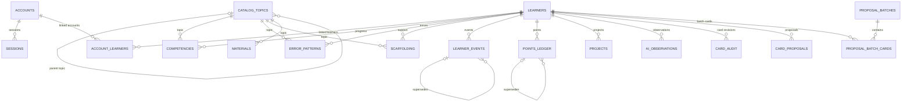

# Локальная схема PostgreSQL и RAG

Схема находится в пространстве имён `teachcopilot`; миграции `001`–`009` применяются по порядку, а последняя версия хранится в `schema_version`. В базе есть одна каноническая карточка ученика (`learners.card`, JSONB) с отдельными реляционными проекциями для выборок и истории.

## Группы таблиц

| Назначение | Таблицы | Что хранится |
|---|---|---|
| Учётные записи и доступ | `accounts`, `sessions`, `account_learners` | Учётная запись с ролью teacher/student/admin, хеш пароля и признак активности; сессии с хешем токена и сроком действия; связь аккаунта с учеником и тип отношения. |
| Карточка ученика и прогресс | `learners`, `competencies`, `error_patterns`, `scaffolding`, `learner_events`, `points_ledger`, `projects`, `ai_observations` | Канонический документ карточки и его ревизия; освоение тем, типичные ошибки и стратегии поддержки; события, баллы, проекты и наблюдения. События и записи баллов имеют ключ источника, активность и ссылку на заменённую запись для исправлений. |
| История изменений карточек и исходников | `card_audit`, `source_snapshots` | Снимок карточки с актором и номером ревизии; уникальные по типу, ключу и версии снимки импортированных карточек, материалов, каталогов и исходных файлов. |
| Каталоги и учебные материалы | `catalog_topics`, `materials`, `embedding_models` | Темы курса и родительская тема; активные фрагменты материалов, метаданные, версия источника и исходный снимок; модель эмбеддинга и её размерность. |
| Предложения и повторяемые операции | `card_proposals`, `proposal_batches`, `proposal_batch_cards`, `save_operations` | Предложенные изменения с базовой ревизией и состоянием; пакет предложений по нескольким ученикам; результат подтверждения; сохранённый результат операции по её идентификатору. |

Карточка при импорте сначала сохраняется как снимок исходника. Если ученик уже есть, импорт пропускает изменение канонической карточки и сообщает о конфликте при несовпадении содержимого. Обновление карточки через хранилище проверяет ожидаемую ревизию; при сохранении пользовательского изменения записывает снимок в `card_audit` и синхронизирует проекции. История исходных событий и баллов сохраняет заменённые версии неактивными.

## Внешние ключи

Диаграмма показывает только заданные внешние ключи. Например, `card_audit.actor_id`, `save_operations.actor_id`, `card_proposals.actor_id` и `proposal_batches.actor_id` хранят идентификатор актора как текст без внешнего ключа на `accounts`. У `source_snapshots` также нет внешнего ключа на исходную сущность.

## Ограничения, поиск и индексы

- Уникальные ключи защищают аккаунты по email, связи аккаунт–ученик, проекции по ученику и теме, записи событий и баллов по источнику, идентификаторы предложений и снимков, а также повторные операции по `operation_id`.
- Проверки ограничивают класс ученика и темы диапазоном 1–12, ревизии положительными числами, mastery/independence интервалом 0–1, а размерность эмбеддинга – диапазоном 1–2000. Для эмбеддинга обязательны зарегистрированная модель и совпадающая размерность.
- Частичные уникальные индексы не допускают двух одновременно активных записей для одного источника события или балла. Индексы ускоряют доступ к сессиям по сроку действия, прогрессу по теме, активным материалам, снимкам аудита и ключам источников.
- `materials.search_document` – сохранённый полнотекстовый документ с русской и простой конфигурациями; для него используется GIN. Векторный поиск в приложении считает cosine similarity только для активных материалов выбранной модели и размерности. Гибридный поиск объединяет ранжирование вектора и полнотекстовый поиск через reciprocal rank fusion (RRF), применяя фильтры предмета/класса/темы.
- При изменении версии или содержимого материала прежний вектор сбрасывается. Обновление векторов сверяет исходные версию и содержимое, а поиск сообщает о неполном покрытии выбранной моделью в отфильтрованном корпусе.

## Политика предложений

Схема хранит предложение и его статус, а подтверждение проверяет владельца предложения и совпадение базовой ревизии; запись карточки и смена статуса выполняются в одной транзакции. Пакет подтверждается как целое. Подготовка черновика задания для учителя – политика приложения, отдельной таблицы черновиков заданий в этих миграциях нет.
