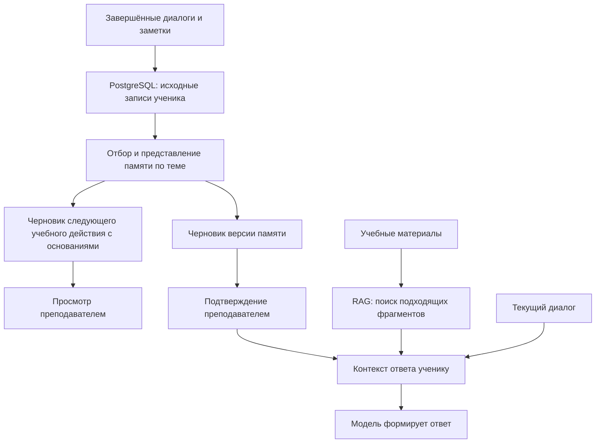

# Память TeachCopilot и ближайшие действия

Сверено с «идз 5 сем.docx» от 19 октября 2026 года. В документе предусмотрены изучение подходов, требования к памяти, способы отбора и представления сведений, прототип TeachCopilot, сравнительная оценка, разбор ограничений и отчётные материалы. Текущий проект соответствует этому направлению. Наличие работающего прототипа не означает, что сравнительная содержательная оценка завершена.

Результаты итогового исследовательского запуска сохранены. Автоматический судья не прошёл калибровку, поэтому формальные содержательные оценки остаются `not_assessed`. Живые демонстрации и программные тесты не заменяют такую оценку и не выбирают победителя среди методов.

## Как устроена память

Это упрощённая схема. Проверка учебного запроса и отдельные вычислительные инструменты на ней не показаны. Дефект остановки продолжения до использования памяти зафиксирован в `live-memory-scenario-2026-10-19/receipt.json`. Доработка и ограниченный живой прогон описаны в `MEMORY_CONTINUATION_RESULTS_2026_10_20.md`; первоначальные отказы сохранены.

RAG для материалов использует текстовый и векторный поиск. Память ученика сейчас отбирается по исследуемым правилам: профиль, хвост истории, сводка или структурированные записи. Рабочий метод по умолчанию – `tail`, максимум 4000 символов выбранного контекста. Подлинные источники остаются в PostgreSQL и после перезапуска. Хранить весь архив и передавать модели весь архив – разные операции.

В широком смысле подстановку извлечённой памяти в запрос тоже можно назвать RAG. Предмет исследования – качество отбора и представления прошлого опыта ученика при ограниченном контексте: ошибки, исправления, помощь, самостоятельные попытки, неизвестные условия и интересы. Сам факт подключения векторного поиска не является исследовательским результатом.

Черновик следующего действия готовится для просмотра преподавателем из доступных источников. Чат использует подтверждённую версию памяти. Реплика ассистента не служит доказательством выполнения задания учеником; автоматическое обновление памяти не подтверждает компетенции.

## Состояние пакета на 20 октября

1. Исправить продолжение прошлого занятия: фраза «продолжим числитель и знаменатель» должна использовать подтверждённый контекст, а при недостатке контекста задавать понятное уточнение. Проверить исходный неудачный пример, новый диалог и запрос без подходящей памяти.
2. Согласовать тему занятия между чатом, памятью и следующим действием. Сейчас «Математика» и «Дробь, числитель и знаменатель» могут храниться под разными ключами. Не смешивать соседние темы или учеников ради успешного демонстрационного ответа.
3. Доработать короткие ответы «хз», «ну вроде», «ага» в нескольких контекстах. В новом демо на «хз» и переключение к кометам получена общая заглушка. Помощник должен выяснять, что ребёнок сделал или понял, и отвечать короче. При отборе памяти сохранить связь вопроса с коротким ответом, явно отделяя вопрос ассистента от доказательства действия ученика. Эти реплики сами по себе не подтверждают решение, самостоятельность или устойчивый интерес. Фактические ответы уже сохранены в `natural-child-demo-2026-10-19/run-02/`; исправления выполнять отдельно от этого демонстрационного прогона.
4. Повторить короткий сквозной сценарий: два занятия, завершение, просмотр памяти преподавателем, перезапуск и новый запрос. Показать исходные реплики, выбранный контекст и полученный ответ. Проверить отдельно сохранность данных и содержательное использование памяти.
5. Собрать отчёт и презентацию по утверждённому заданию. Использовать сохранённые эксперименты, явно разделить технические результаты, содержательную оценку и ограничения. Не перезаписывать старые эксперименты и не выдавать демонстрацию за отложенный тест.

Пункты 1–3 реализованы в приложении и покрыты программными проверками. Для пункта 4 выполнен ограниченный прогон: после просмотра синтетической памяти и перезапуска два сообщения получили учебные ответы; Python без подходящей памяти получил уточнение. Также сохранены четыре технических отказа и первоначальная содержательная ошибка объяснения. Это не подтверждение общей надёжности. Итог и границы – в `MEMORY_CONTINUATION_RESULTS_2026_10_20.md`.

Пункт 5 подготовлен 20 октября: [отчёт, презентация и воспроизводимый аудит](research-report-2026-10-20/README.md). В отчёте сопоставлены все семь задач индивидуального задания. Разобраны случаи исправления источника, чрезмерного обобщения, неверных примеров и полезного продолжения незавершённой работы. Это дополнительный AI-разбор; все 128 формальных оценок остаются not_assessed. Сборка документов не означает завершения содержательного сравнения.

Ближайший инженерный пакет – проверка памяти на других темах и отдельный аудит внешней проекции нового контекста ассистента. Реалистичные короткие и неоднозначные реплики остаются ориентиром демонстраций. Исходные замороженные истории не переписываются. Для формального содержательного сравнения нужен независимый человеческий просмотр либо новый заранее описанный и успешно квалифицированный протокол оценки, оформленный отдельно от исходного опыта.
